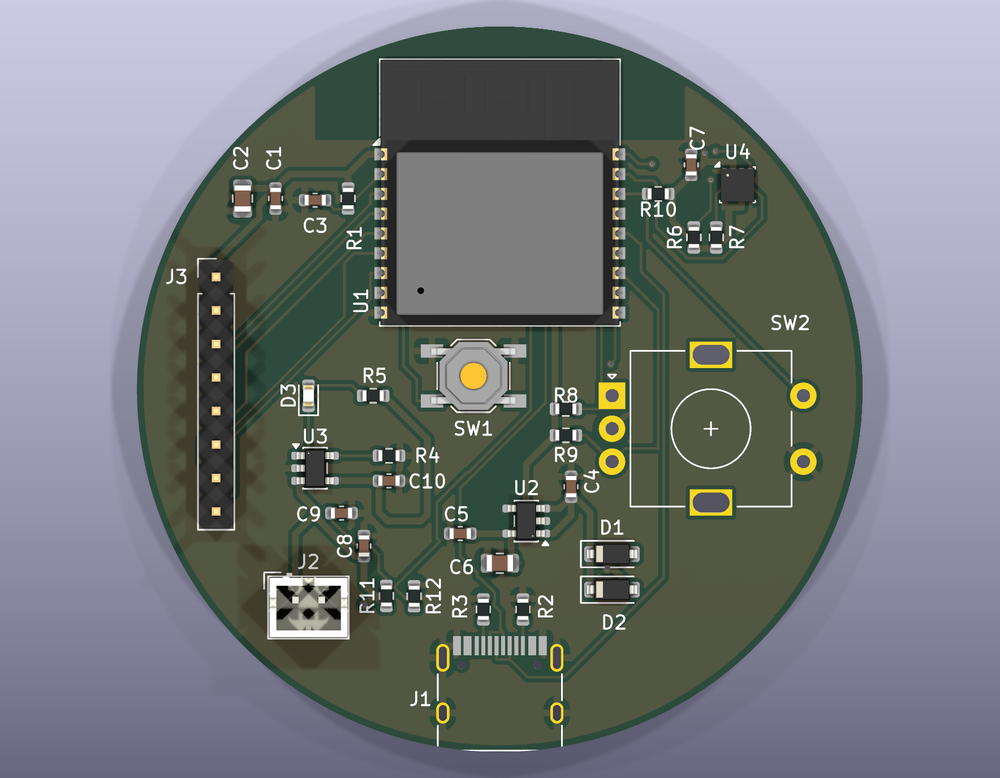
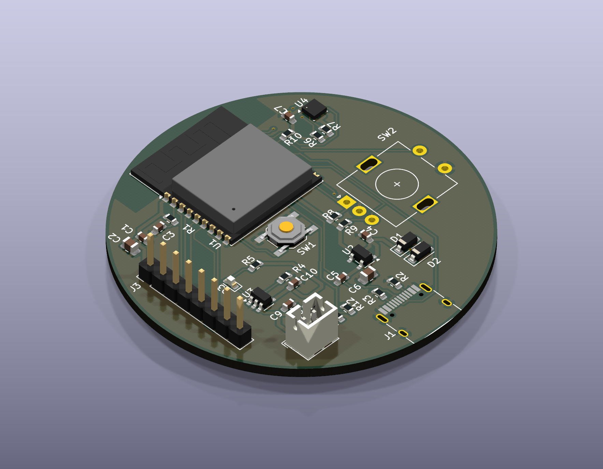
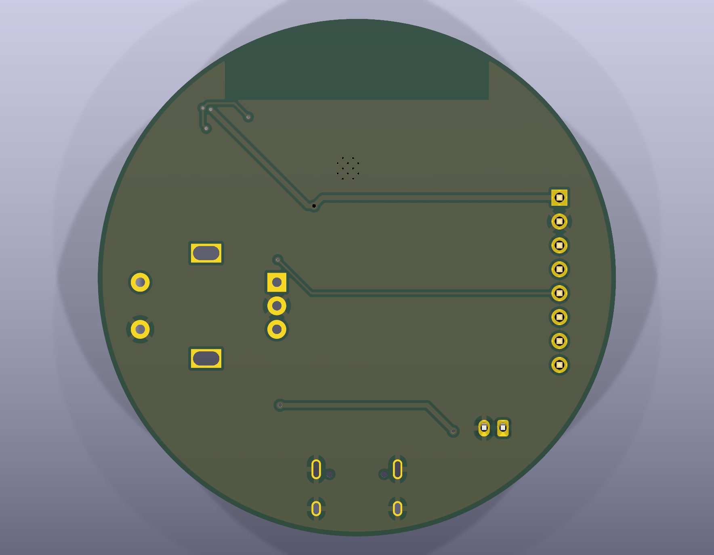

# Round Desk Companion (desk-clock-pcb)

A small round desk gadget (clock / weather / room sensor), designed as a first
KiCad 9 project: a 2-layer, 55 mm round PCB around an ESP32-C3 module, powered
over USB-C or a LiPo cell.

**Status:** schematic complete (ERC clean), PCB laid out and routed, DRC being
finished. Not fabricated yet — no hardware results are claimed here.

## Preview

3D renders generated with `kicad-cli` from the current board state (work in progress).

Bottom side (ground pour, a few hop routes; all parts are on top):

Schematic: [docs/desk-clock-schematic.pdf](docs/desk-clock-schematic.pdf)

## What is on the board

| Block | Part | Notes |
|---|---|---|
| MCU + radio | ESP32-C3-WROOM-02 | Wi-Fi, native USB on IO18/IO19, antenna at the board edge with copper keep-out |
| USB | USB-C receptacle | 5.1 k on CC1/CC2 (sink), D+/D- tied across both orientations |
| Charger | MCP73831 | ~500 mA (R-PROG 2 k), charge LED on STAT |
| Power path | 2x Schottky diode-OR | USB (VBUS) or battery -> VSYS |
| Regulator | AP2112K-3.3 | LDO, VSYS -> +3V3 |
| Display | 8-pin 2.54 mm header | 1.28" round GC9A01 over SPI (cable) |
| Sensor | BME280 | I2C, 4.7 k pull-ups |
| Input | Rotary encoder + push | pull-ups on A/B/SW |
| Battery sense | 100 k / 100 k divider | to ADC (IO3) |

### GPIO map

| Pin | Function | Pin | Function |
|---|---|---|---|
| IO0 | I2C_SCL | IO8 | DISP_BL |
| IO1 | I2C_SDA | IO9 | BOOT button |
| IO2 | ENC_SW | IO10 | DISP_RST |
| IO3 | BAT_SENSE | IO18 | USB D- |
| IO4 | DISP_SCK | IO19 | USB D+ |
| IO5 | DISP_MOSI | IO20 | ENC_A |
| IO6 | DISP_CS | IO21 | ENC_B |
| IO7 | DISP_DC | | |

## Layout notes

- 2 layers, GND pour on both; antenna end of the module placed at the board edge
  with a copper/track/via keep-out underneath.
- Net class `Power` (0.5 mm) for VBUS, +BATT, VSYS, +3V3; 0.2 mm elsewhere.
- Rules chosen to stay inside JLCPCB 2-layer limits (0.2 mm clearance, 0.6/0.3 mm vias).
- Critical nets were routed by hand; the remainder with FreeRouting, then cleaned
  up (stray vias and stubs removed, track widths raised to the 0.2 mm rule).

## Known limitations / what I would change

- Two layers get crowded around the USB-C connector and the charger; a 4-layer
  stack-up (signal / GND / power / signal) would let USB and the display bus run
  without vias.
- The LDO drops ~1.4 V from USB: fine on average Wi-Fi load, but a buck converter
  would run cooler (rev B).
- No ESD protection on the USB data lines and no battery-side fuse (rev B).
- The ESP32 module footprint has nine 0.2 mm thermal vias, below the 0.3 mm DRC
  minimum I set; to be revisited before ordering.

## Files

- `desk-clock.kicad_pro / .kicad_sch / .kicad_pcb` — KiCad 9 project
- `scripts/` — small KiCad scripting-console helpers used for placement
- `docs/` — schematic PDF and 3D renders

Open the `.kicad_pro` in KiCad 9.
